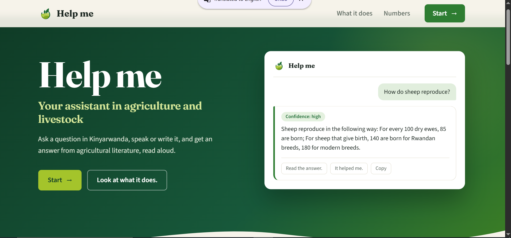
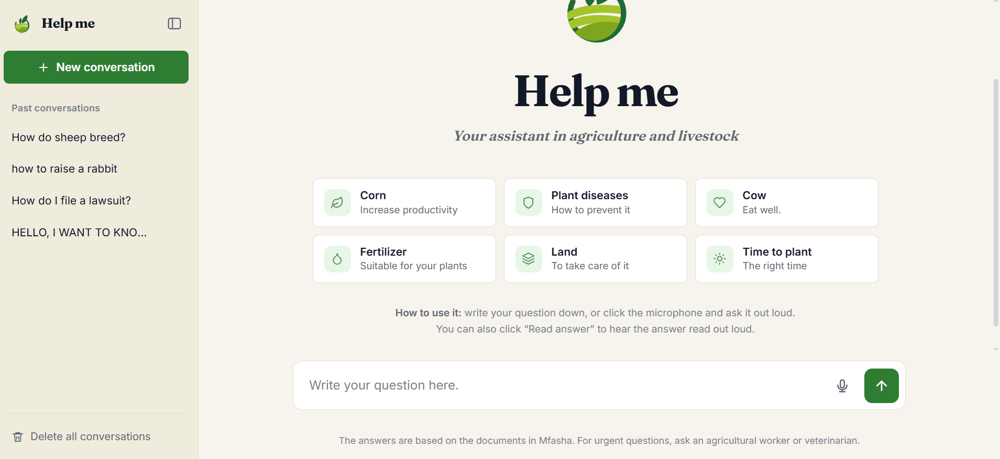

# MFASHA: A Kinyarwanda Agriculture Chatbot with Text and Voice Support

BSc. in Software Engineering, African Leadership University (ALU). Capstone project, 2026.

| | |
|---|---|
| Student | Carine Ahishakiye Yibukabayo |
| Supervisor | Hubert Apana |
| Repository | https://github.com/carine-ahishakiye/Mfasha-Chatbot- |
| Walkthrough video | https://drive.google.com/file/d/1qTrdZHF_zQFk6N2t_sgxITCM8oXIIJ8a/view?usp=drive_link |


MFASHA lets a farmer ask an agricultural question in Kinyarwanda, by typing it or by recording it, and get a written answer that can also be read aloud. Answers are not generated. Each one is a passage taken unchanged from a Kinyarwanda agricultural collection, and when no passage matches well enough the app says so instead of guessing.

The interface is in Kinyarwanda. A short English glossary of the labels is in [Screenshots](#screenshots).

## Contents

1. [Why this project](#why-this-project)
2. [How it works](#how-it-works)
3. [Results](#results)
4. [Scope alignment with the proposal](#scope-alignment-with-the-proposal)
5. [Screenshots](#screenshots)
6. [Technical requirements](#technical-requirements)
7. [Installation and running](#installation-and-running)
8. [Configuration](#configuration)
9. [API](#api)
10. [Testing](#testing)
11. [Code structure and design](#code-structure-and-design)
12. [Repository layout](#repository-layout)
13. [Limitations](#limitations)
14. [Data, ethics and intended use](#data-ethics-and-intended-use)
15. [References](#references)

## Why this project

The National Institute of Statistics of Rwanda (2025) reports about 2.2 million agricultural households in 2024, 65.3% of all households. Most of them still depend on extension officers, radio and meetings, and none of these can answer a question when a problem shows up in the field. Tunga, the Ministry's Kinyarwanda voice assistant, works through a phone call, so it depends on the call connecting and the call centre being open. MFASHA is meant as an extra channel next to it: a farmer can send a question at any time, in text or voice, and read or replay the answer.

Two choices follow from the proposal and shape the whole design:

- **Retrieval, not generation.** Machine-generated agricultural advice needs expert checking before farmers can rely on it (Ibrahim et al., 2024). MFASHA returns stored passages only.
- **Referral instead of guessing.** If the best passage scores below a threshold, the farmer gets a referral message and no answer.

## How it works

```
 Typed question ─────────────────────────────┐
                                             │
 Recorded question ─► decode audio ─► speech-to-text ─┤
   (browser)          (16 kHz mono)   MMS-1b-all +    │
                                      fine-tuned      │
                                      Kinyarwanda     │
                                      adapter         ▼
                                              clean text
                                                  │
                                       embed question (fine-tuned
                                       multilingual-e5-large)
                                                  │
                                  cosine similarity against 941
                                  pre-computed passage embeddings
                                                  │
                         best score >= threshold? │
                          yes ◄───────────────────┴───────────────► no
                           │                                         │
                  answer = top passage, unchanged            referral message
                  + confidence level + 2 related passages
                           │
                  text-to-speech on request
                  (facebook/mms-tts-kin)
```

| Stage | What is used | Where in the code |
|---|---|---|
| Voice capture | `MediaRecorder` in the browser, uploaded to the server | `mfasha/web/static/chat.js`, `POST /api/transcribe` |
| Audio decoding | PyAV decodes webm, ogg, mp4 or wav to 16 kHz mono; falls back to `soundfile` for plain WAV | `mfasha/audio.py` |
| Speech-to-text | `facebook/mms-1b-all` with the Kinyarwanda adapter; adapter and output layer fine-tuned in this project | `mfasha/asr.py` |
| Text cleaning | Fixes spacing around punctuation and apostrophes, the same cleaning the passages got during data preparation | `mfasha/text_utils.py` |
| Retrieval | `intfloat/multilingual-e5-large`, fine-tuned on the training questions; dot product on normalised vectors, top 5 returned | `mfasha/retriever.py` |
| Answer or referral | Top passage is returned only if its score reaches the threshold in `results/referral_threshold.json` | `mfasha/pipeline.py` |
| Confidence level | high, medium or low, from the best score and its gap to the second-best | `mfasha/confidence.py` |
| Text-to-speech | `facebook/mms-tts-kin`, one clause at a time with pauses, numbers and units written out as Kinyarwanda words first | `mfasha/tts.py`, `mfasha/kin_numbers.py` |
| Voice caching | The voice for an answer is made once, cached, and started in the background while the farmer reads | `mfasha/voice.py` |

### Technical points worth knowing

- **Hard-negative training for retrieval.** The retriever was fine-tuned with `CachedMultipleNegativesRankingLoss`. For every training question, one wrong passage was drawn from the BM25 top results (ranks 2 to 15, restricted to passages that appear as training positives) and used as an extra negative. The 250k-row word embedding table was frozen so training fits on a 15 GB T4.
- **Threshold chosen from data.** The referral threshold is not typed in by hand. It is the 5th percentile of the best-passage score over the dev questions that were answered correctly, so 95% of correctly retrieved dev questions are kept. The notebook writes it to `results/referral_threshold.json` (0.5723, from 2,693 dev questions).
- **Two kinds of test split.** `test_seen` holds out questions whose passage was used in training, which matches real use because the same collection is searched. `test_unseen` holds out whole passages that the model never saw during training, which shows how it copes with new content. Neither split shares a question with training, and the unseen splits share no passage with training either (checked with asserts in the notebook).
- **Spoken answers.** Passages are long, so the app reads at most 250 characters, cut at a sentence or clause boundary. Digits are converted to Kinyarwanda words, because the voice model cannot read them (`mfasha/kin_numbers.py`).
- **Concurrency.** One request at a time uses the speech recogniser and one the speech model (locks in `services.py` and `voice.py`). If two requests ask for the same voice, the second waits for the first instead of generating it again. A sliding-window rate limiter caps requests per visitor.

## Results

All figures below come from the notebook (`notebook/mfasha_agri_bot.ipynb`) and the files it saved in `results/`. Experiments ran on Google Colab with a Tesla T4. Nothing here was estimated by hand.

### Data

The retrieval collection has 984 passages, of which 43 contained only a heading and were dropped, leaving **941**. After cleaning, the splits used for evaluation are:

| Split | Questions | Passages |
|---|---|---|
| train | 14,232 | 850 |
| dev_seen | 1,394 | 697 |
| test_seen | 1,394 | 697 |
| dev_unseen | 1,299 | 60 |
| test_unseen | 329 | 20 |

### Retrieval

Test-set results, using R@k (the right passage is in the top k) and MRR@10. Best figures are in bold.

| System | test_seen R@1 | test_seen MRR@10 | test_unseen R@1 | test_unseen MRR@10 |
|---|---|---|---|---|
| BM25 (baseline) | 0.487 | 0.595 | 0.489 | 0.599 |
| paraphrase-multilingual-mpnet (first model tried) | 0.032 | 0.054 | 0.046 | 0.069 |
| LaBSE | 0.082 | 0.133 | 0.085 | 0.121 |
| bge-m3 | 0.348 | 0.446 | 0.328 | 0.427 |
| multilingual-e5-large, not fine-tuned | 0.400 | 0.491 | 0.316 | 0.396 |
| BM25 + multilingual-e5-large | 0.517 | 0.629 | 0.468 | 0.595 |
| **multilingual-e5-large, fine-tuned (used in the app)** | **0.893** | **0.936** | **0.866** | **0.923** |

For the fine-tuned model, R@5 is 0.990 on test_seen and 0.988 on test_unseen, and R@10 is 0.994 on both. The first of these is in `results/retrieval_final_test.csv`; the full comparison is in `results/retrieval_baselines.csv`. Off-the-shelf embedding models were weaker than BM25 on Kinyarwanda, and fine-tuning is what made the neural retriever worth using. Fine-tuning ran for 3 epochs; dev R@1 on the seen split went 0.886, 0.912, 0.912, so the later epochs added little (`results/retrieval_epoch_history.csv`).

Where it fails: most errors come from passages about nearly the same topic, for example two passages on orange tree pruning or on vaccination schedules for laying hens. These are in `results/plots/5_confused_pairs.png`.

### Referral threshold

| Measure (dev questions, n = 2,693) | Value |
|---|---|
| Threshold (cosine similarity) | 0.5723 |
| Questions answered | 90.5% |
| Right passage among answered questions | 91.1% |
| Wrong-top-passage questions that were referred instead | 139 of 356 |

In a small hand check with three off-topic questions (a football result, how to make a phone app, a bus fare), all three were referred, with best scores between 0.19 and 0.34. Six farming questions in the same check scored between 0.60 and 0.82 (`results/ask_samples.csv`). The file `eval/off_topic_rw.txt` holds 18 off-topic questions for a larger check with `scripts/evaluate_answers.py`.

### Speech-to-text

Test set: 200 sentences (19 minutes of audio) from one voice in the agricultural speech collection that was kept out of training and out of the tuning data. Training used 2,000 clips (2.4 hours) from the other three voices.

| | WER | WER without apostrophes | CER |
|---|---|---|---|
| MMS-1b-all, Kinyarwanda adapter as published | 0.301 | 0.293 | 0.063 |
| Same, adapter fine-tuned in this project | **0.277** | **0.269** | **0.058** |

Best dev WER during fine-tuning was 0.284 at epoch 3 (`results/asr_finetune_history.csv`). The improvement is modest. Transcribing the 200 test clips with the published model took 195 s on the T4.

### Text-to-speech

A VITS model (`facebook/mms-tts-kin`) was also fine-tuned on one voice from the speech collection (3,046 clips, 3.4 hours). It was compared with the stock model by speaking an answer, transcribing it back with the speech recogniser, and measuring the word error rate. The stock voice scored better (0.228 against 0.695, as recorded in `mfasha/config.py`), so the app uses the stock model. Listening samples are in `results/tts_samples/`. Native-speaker clarity and naturalness ratings were not collected.

### Response time

The nine questions in `results/ask_samples.csv` were answered in 0.06 to 0.09 s each (embedding the question, ranking, applying the threshold) on the Colab T4. Speech-to-text and text-to-speech take longer and depend on hardware. `scripts/benchmark_latency.py` measures every stage on CPU or GPU and writes a hardware description alongside the timings. No benchmark output is stored in this repository yet.

## Scope alignment with the proposal

The proposal listed candidate components and said any of them could be adopted, replaced or dropped depending on the evidence. This table compares the plan with what is in the repository.

| Planned feature | Purpose | Status | Evidence |
|---|---|---|---|
| Typed Kinyarwanda question and written answer | Basic question answering | Completed | `POST /api/ask`, `mfasha/pipeline.py`, `tests/test_api.py` |
| Voice question recorded in the browser | Farmers who find typing hard | Completed | `chat.js` recorder, `POST /api/transcribe`, `mfasha/audio.py` |
| Kinyarwanda speech-to-text, assessed with WER | Turn the recording into text | Completed, with a different model than the three named in the proposal. The proposal had not chosen one | `mfasha/asr.py`, `results/asr_*.csv`, WER 0.277 |
| Text preprocessing | Consistent input | Completed | `mfasha/text_utils.py` |
| Question classification (KinyaBERT against TF-IDF with Logistic Regression and SVM) | Narrow the search and detect out-of-scope questions | Not implemented. There are no topic labels and no classifier stage. Out-of-scope questions are caught by the retrieval score threshold only | See `mfasha/pipeline.py` |
| Retrieval and ranking against baselines | Find the right passage | Completed, with a different candidate set. kiny-colbert-free was not evaluated. BM25, four off-the-shelf embedding models and hybrids were compared, and the winner was fine-tuned. A TF-IDF baseline was not run | `notebook/`, `results/retrieval_*.csv`, `results/plots/` |
| Verified answer with a confidence threshold and referral | Avoid wrong answers | Partially completed. The threshold and referral work. The officer review of passages did not happen: the review sheet has 941 passages with a risk level, and no officer decision filled in | `results/referral_threshold.json`, `results/passages_for_officer_review.xlsx` |
| Text-to-speech with kinya-flex-tts | Spoken answers | Completed, with a different model. `facebook/mms-tts-kin` is used. kinya-flex-tts was not evaluated. A fine-tuned version was tried and not adopted | `mfasha/tts.py`, notebook cells on TTS |
| Written and spoken answer in a simple web interface | Usable by farmers with limited technical experience | Completed. FastAPI with plain HTML, CSS and JavaScript instead of Streamlit. Interface text is in Kinyarwanda | `mfasha/web/` |
| Feedback from users | Measure usefulness | Completed in a simpler form. Votes are appended to `results/feedback.jsonl` | `POST /api/feedback` |
| PostgreSQL storage of questions, answers and model versions | Evaluation data | Not implemented. Only feedback votes are stored, in a JSON Lines file | `mfasha/web/routes.py` |


## Screenshots

The interface is in Kinyarwanda. Labels you will see:

| Kinyarwanda | English |
|---|---|
| Vuga | Speak |
| Rangiza | Finish (stop recording) |
| Soma igisubizo | Read the answer aloud |
| Icyizere: kinshi / giciriritse / gike | Confidence: high / medium / low |
| Byamfashije / Ntibyamfashije | It helped me / It did not help me |
| Mbabarira, nta makuru mfite kuri icyo kibazo. | Sorry, I have no information on that question. (the referral message) |

![Landing page]

![Chat with an answer]


## Technical requirements

Versions below are the ones declared in `pyproject.toml`, `requirements.txt` and `requirements-dev.txt`.

| Requirement | Version |
|---|---|
| Python | 3.10 or newer |
| FastAPI, Uvicorn, Pydantic | 0.110+, 0.29+, 2.0+ |
| PyTorch | not pinned |
| Transformers, Sentence-Transformers | 4.45+, 3.0+ |
| huggingface_hub, numpy, scipy, librosa, soundfile, av, python-dotenv | not pinned |
| Development only: pytest, httpx, pandas, jiwer | not pinned |

Models the app loads (see `mfasha/config.py`):

| Component | Model |
|---|---|
| Speech-to-text | `facebook/mms-1b-all`, Kinyarwanda adapter, plus the fine-tuned weights in `models/mms-kin-adapter/best.pt` |
| Retrieval | `intfloat/multilingual-e5-large` fine-tuned, in `models/kinya-e5-large/best` |
| Text-to-speech | `facebook/mms-tts-kin` |

Hardware and environment:

- Experiments and training ran on Google Colab with a Tesla T4 (15 GB).
- The app uses a GPU if there is one. Without a GPU, typed questions are still quick, but voice questions take much longer. Setting `MFASHA_FAST_ASR=1` turns on int8 quantisation of the speech recogniser on CPU.
- The first start downloads several gigabytes (the trained files and the MMS weights; `DEPLOY.md` estimates about 6 GB in total).
- A browser with microphone support is needed for voice questions. Browsers only allow microphone access on HTTPS or on `localhost`.

## Installation and running

### 1. Get the code

```bash
git clone https://github.com/carine-ahishakiye/Mfasha-Chatbot-.git
cd Mfasha-Chatbot-
```

### 2. Install dependencies

Windows (PowerShell):

```powershell
python -m venv .venv
.\.venv\Scripts\Activate.ps1
pip install -r requirements-dev.txt
```

Linux or macOS:

```bash
python3 -m venv .venv
source .venv/bin/activate
pip install -r requirements-dev.txt
```

`requirements.txt` is enough if you only want to run the app.

### 3. Get the trained files

The trained weights are too large for Git and are in a private Hugging Face repository (`models/` is in `.gitignore`). The passages (`data/clean/passages.jsonl`), the passage embeddings (`results/emb/kinya_e5_passages.npy`) and the threshold file are already in this repository. Two folders are not: `models/kinya-e5-large/best/` and `models/mms-kin-adapter/best.pt`.

Copy `.env.example` to `.env` and fill in:

```
HF_TOKEN=<a Hugging Face read token with access to the assets repo>
HF_ASSETS_REPO=<owner>/<assets repo name>
```

On first start the app downloads whatever is missing. If you do not have access to the assets repository, contact the author. To rebuild the files yourself, run `notebook/mfasha_agri_bot.ipynb` on Colab (see below).

### 4. Start the app

```bash
python app.py
```

Open http://127.0.0.1:7860. The port can be changed with the `PORT` variable. Wait for the line `ready` in the terminal before asking a question, because the models load and warm up first.

### Rebuilding the models (optional)

`notebook/mfasha_agri_bot.ipynb` is a Colab notebook. It expects a Google Drive folder named `Mfasha chatbot` and a Colab secret called `HF_TOKEN`. In order, it downloads and cleans the retrieval collection, builds the splits, compares the retrieval systems, fine-tunes the retriever, sets the referral threshold, fine-tunes the speech recogniser, and fine-tunes a text-to-speech voice. `scripts/colab_push_assets.py` uploads the results to the private Hugging Face repository.

## Configuration

Set these in `.env` (see `.env.example` and `mfasha/config.py`).

| Variable | Purpose |
|---|---|
| `HF_TOKEN` | Hugging Face token used to download the trained files |
| `HF_ASSETS_REPO` | Repository that holds the trained files |
| `REFERRAL_THRESHOLD` | Optional. Overrides `results/referral_threshold.json`. `0` means never refer |
| `TOP_K` | Optional. Passages retrieved per question (default 5) |
| `MAX_AUDIO_SECONDS` | Optional. Longest accepted recording (default 30) |
| `TIER_MIN_SCORE`, `TIER_HIGH_MARGIN`, `TIER_MEDIUM_MARGIN` | Optional. Cutoffs for the confidence level |
| `MFASHA_FAST_ASR` | Optional. `1` turns on int8 speech recognition on CPU |
| `PORT` | Optional. Server port (default 7860) |

If `results/referral_threshold.json` is missing the threshold falls back to 0 and no question is ever referred, so keep that file committed.

## API

| Method and path | Purpose |
|---|---|
| `GET /` | Landing page |
| `GET /chat` | Chat interface |
| `GET /health` | Returns whether the models are loaded |
| `POST /api/ask` | Body `{"question": "..."}`. Returns the answer, `refused`, `tier`, related passages and `passage_id` |
| `POST /api/transcribe` | Raw audio in the request body. Returns `{"text": "..."}` |
| `POST /api/speak` | Body `{"text": "..."}`. Returns a WAV file |
| `POST /api/feedback` | Body with `question`, `passage_id` and `vote` (`helpful` or `not_helpful`) |

Limits: questions up to 500 characters, uploads up to 20 MB, recordings up to 30 s, and per-visitor rate limits of 20 questions, 8 recordings and 40 speech requests per minute.

## Testing

### Automated tests

```bash
python -m pytest tests
```

42 tests pass. They use small fake models, so no downloads are needed and they run in about a second.

| File | What it covers |
|---|---|
| `tests/test_pipeline.py` | Answer, refer and empty cases; a score exactly at the threshold; threshold 0; the voice path; threshold read from config and from file |
| `tests/test_api.py` | Every endpoint: valid questions, empty, too long and missing fields, a crashing model returning a friendly error, rate limiting on the 21st question, broken and empty audio, empty text to speak, feedback saving and bad votes, search speed |
| `tests/test_confidence.py` | Confidence levels, including a single result and missing cutoffs |
| `tests/test_numbers_and_text.py` | Number-to-words conversion, percentages, units, ranges, decimals, text cleaning |
| `tests/test_voice_and_audio.py` | Cutting long answers for speech, caching, cache size limit, WAV round trip |
| `tests/test_ratelimit.py` | Limit reached, then freed after the time window |

### Model and system checks

| Script | Purpose |
|---|---|
| `scripts/smoke_test.py` | Loads each real model on its own and checks it works |
| `scripts/evaluate_answers.py` | Asks farming questions taken from unseen passages plus off-topic questions, and reports how many were answered correctly and referred correctly |
| `scripts/evaluate_system.py` | Retrieval, confidence calibration, answers and speech evaluation, with bootstrap 95% intervals, written to `results/evaluation_report.md` |
| `scripts/benchmark_latency.py` | Per-stage and end-to-end timing on CPU or GPU, with hardware details |

### Testing approaches used

1. **Unit and functional testing** of the pipeline, text utilities, confidence rules, rate limiter and voice cache, with fake models so the logic is tested apart from the models.
2. **Integration testing** of the web endpoints through FastAPI's test client, covering both the normal path and error handling.
3. **Held-out evaluation** of the models, with seen and unseen splits for retrieval and a held-out speaker for speech recognition, so scores are not measured on training data.
4. **Manual checks** on a small set of farming and off-topic questions (`results/ask_samples.csv`).

Browser, operating-system and low-end hardware compatibility have not been tested systematically yet. Run `scripts/benchmark_latency.py --device cpu` and `--device cuda` on the machines available and add the output to `results/` before citing performance figures beyond the T4 numbers above.

## Code structure and design

The code is split so each part can be tested and replaced on its own.

- **Interfaces.** `mfasha/interfaces.py` defines three abstract classes, `PassageSearcher`, `SpeechRecognizer` and `SpeechSynthesizer`. The retriever, the transcriber and the speaker implement them.
- **Dependency injection.** The `Mfasha` pipeline receives its searcher and recogniser through the constructor. `create_app()` takes optional ready-made objects. This is how the tests run the real application code with fake models.
- **Thin web layer.** Route handlers in `mfasha/web/routes.py` validate input, call a service and shape the JSON. Shared objects (rate limiters, voice service, confidence policy) live in one `Services` dataclass built per application, so tests can create as many apps as they need.
- **Single responsibility.** Confidence rules (`confidence.py`), rate limiting (`ratelimit.py`), audio decoding (`audio.py`), number conversion (`kin_numbers.py`) and asset download (`assets.py`) each have their own module.
- **Configuration in one place.** Paths, model names and limits are in `mfasha/config.py` and can be overridden through the environment.
- **Evaluation code is part of the package.** `mfasha/evaluation.py` holds the metrics and bootstrap intervals, and the scripts call it.

## Repository layout

```
Mfasha-Chatbot-/
├── app.py                    Entry point, builds the FastAPI app
├── mfasha/
│   ├── pipeline.py           Answer or refer logic
│   ├── retriever.py          Passage search
│   ├── asr.py                Speech-to-text
│   ├── tts.py                Text-to-speech
│   ├── voice.py              Spoken-answer service with cache
│   ├── audio.py              Audio decoding and WAV encoding
│   ├── confidence.py         Confidence levels
│   ├── text_utils.py         Text cleaning
│   ├── kin_numbers.py        Numbers and units as Kinyarwanda words
│   ├── ratelimit.py          Per-visitor rate limiter
│   ├── assets.py             Downloads the trained files
│   ├── interfaces.py         Abstract classes
│   ├── evaluation.py         Metrics used by the scripts
│   ├── config.py             Paths, model names, limits
│   └── web/                  app.py, routes.py, services.py, schemas.py,
│                             messages.py, templates/, static/
├── scripts/                  smoke_test, evaluate_answers, evaluate_system,
│                             benchmark_latency, colab_push_assets
├── tests/                    pytest suite
├── notebook/                 mfasha_agri_bot.ipynb (data, training, evaluation)
├── data/clean/               Cleaned passages, queries and splits
├── results/                  Metrics (CSV), plots, embeddings, threshold,
│                             audio samples, review sheet
├── eval/                     off_topic_rw.txt
├── docs/screenshots/         Screenshots used in this README
├── DEPLOY.md                 Deployment notes
├── requirements.txt
├── requirements-dev.txt
├── pyproject.toml
└── .env.example
```

## Limitations

- **Speech recognition is the weakest part.** A word error rate of 27.7% was measured on read, studio-quality speech from one held-out speaker. Real farmers' phone recordings, with background noise and different accents, were not measured and are likely to be harder. Typed questions are more reliable.
- **Passages are not officer-reviewed.** The proposal said only reviewed entries would be served. The review sheet is prepared (941 passages with a risk level) but has no decisions in it. Answers should be treated as taken from the published collection, not as expert-verified advice.
- **Small unseen test set.** `test_unseen` has 329 questions from 20 passages, so its scores are noisy. Treat the seen and unseen figures together.
- **No topic classifier.** Out-of-scope detection depends on a single similarity threshold. Questions that are close to farming but outside the collection can still receive a loosely related passage, which is why the confidence level and related passages are shown.
- **Answers are whole passages.** Some are long, and speech is limited to the first 250 characters.
- **Needs internet and a large first download.** Voice questions are slow without a GPU.
- **No user evaluation in this repository.** Usability and satisfaction results from farmers and officers are not included.
- **Other languages are not supported.**

## Data, ethics and intended use

- The passages and the speech data come from two public Kinyarwanda collections published by C4IR-RW on Hugging Face: [`kinya-ag-retrieval`](https://huggingface.co/datasets/C4IR-RW/kinya-ag-retrieval) and [`kinya-ag-tts`](https://huggingface.co/datasets/C4IR-RW/kinya-ag-tts). They are used under their published terms and credited here. No new data was collected from farmers for training.
- Test sentences for speech recognition were removed from every training and tuning set, and the notebook asserts that none overlap.
- The server keeps no recordings. Feedback votes store the question text (up to 500 characters), the passage id and the vote. Conversation history is kept in the user's own browser (`localStorage`).
- MFASHA is a support tool. It does not replace extension officers and is not an emergency service. For urgent animal-health or crop problems, farmers should contact an agricultural officer or a veterinarian.

