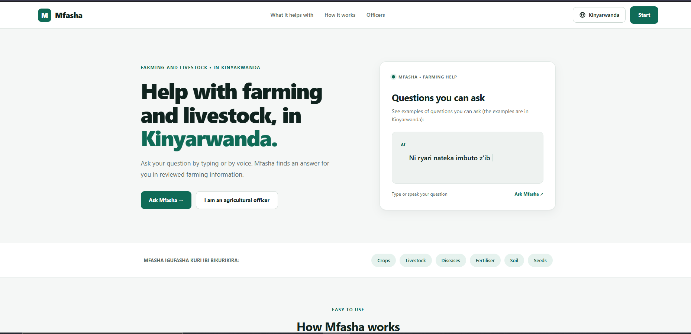
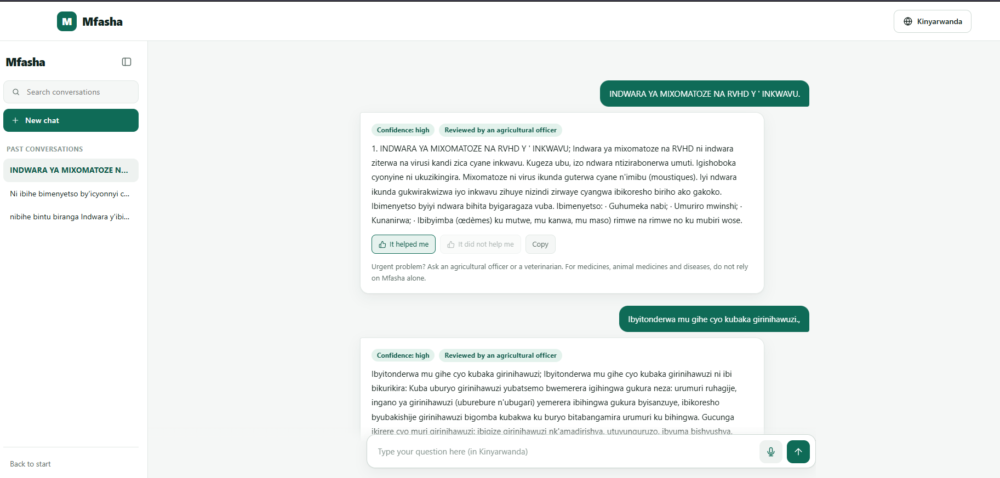

<div align="center">

# MFASHA

### A verified Kinyarwanda agriculture assistant for text and voice

Answers farmers' questions from an officer-reviewed knowledge base, and refers them to an agricultural officer whenever it is not sure.

[](https://mfasha-chatbot.vercel.app)
[](https://huggingface.co/spaces/carine01/mfasha-kinyarwanda-agri-bot)
[](https://huggingface.co/carine01/kinya-e5-large)


[Live demo](https://mfasha-chatbot.vercel.app) · [Walkthrough video](https://drive.google.com/file/d/1dX1bElXRN0jQPMJG-gUhC0-cSth29_TQ/view?usp=sharing) · [Technical report](https://drive.google.com/file/d/1fCGWlLDgnMNojanflFUv4JIrvKef4C1B/view?usp=sharing) · [API docs](#api-reference)

</div>

---

## Table of contents

- [Overview](#overview)
- [Key features](#key-features)
- [Screenshots](#screenshots)
- [Live deployment](#live-deployment)
- [How it works](#how-it-works)
- [Quick start](#quick-start)
- [Configuration](#configuration)
- [Officer access](#officer-access)
- [API reference](#api-reference)
- [Deployment](#deployment)
- [Repository structure](#repository-structure)
- [Results](#results)
- [Testing and code quality](#testing-and-code-quality)
- [Data and model sources](#data-and-model-sources)

---

## Overview

Smallholder farmers often need quick, trustworthy answers about crops, livestock, pests and fertiliser, in their own language. MFASHA lets a farmer type a question or record a voice message in **Kinyarwanda** and receive a written answer.

The system is deliberately **retrieval-only**. It never generates advice. It looks up passages in a knowledge base that agricultural officers have reviewed, and when it is not confident, it says so and **refers the farmer to an officer**. Questions unrelated to farming receive a clear reply in Kinyarwanda explaining what MFASHA can and cannot answer.

```
voice -> speech-to-text -> preprocessing -> classification -> retrieval -> referral policy -> answer
```

## Key features

| | |
|---|---|
| **Text and voice input** | Farmers type or speak; speech is transcribed with MMS (`facebook/mms-1b-all`, Kinyarwanda adapter). |
| **Verified answers only** | Passages are served only if an officer has signed them off. |
| **Safe by design** | A chain of referral rules sends uncertain, ambiguous or off-topic questions to a human. |
| **Fine-tuned retrieval** | A Kinyarwanda-tuned e5 model reaches R@1 of 0.87 to 0.89 on held-out questions (see [Results](#results)). |
| **Officer dashboard** | Officers sign in with a phone number and PIN, review logged answers, and mark them correct or incorrect. |
| **Operational visibility** | Every answer is logged with per-stage latency; an admin endpoint reports referral rate, ratings and officer-correct rate. |
| **Swappable components** | Retrievers, classifier and speech-to-text sit behind interfaces and are chosen by configuration. |
| **No-build frontend** | Plain HTML, CSS and JavaScript in Kinyarwanda. |

## Screenshots

**Landing page.** Farmers can start asking questions straight away or read how MFASHA works first.



**Chat page.** A question in Kinyarwanda gets a verified answer with a confidence badge, feedback and copy buttons, and a list of past conversations. Questions can be typed or spoken.



## Live deployment

| Resource | Link |
|---|---|
| Web app | https://mfasha-chatbot.vercel.app |
| Farmer chat | https://mfasha-chatbot.vercel.app/chat.html |
| Officer page | https://mfasha-chatbot.vercel.app/officer.html |
| Backend (Hugging Face Space) | https://huggingface.co/spaces/carine01/mfasha-kinyarwanda-agri-bot |
| Fine-tuned retrieval model | https://huggingface.co/carine01/kinya-e5-large |
| Source code | https://github.com/carine-ahishakiye/Mfasha-Chatbot- |


## How it works

MFASHA is a FastAPI application with a Kinyarwanda web interface for farmers and officers. The model work (retrieval fine-tuning, speech recognition, evaluation) lives in `Notebooks/mfasha_notebook.ipynb`; this repository turns those results into a deployable service.

### Answer pipeline (`src/mfasha/pipeline.py`)

1. **Speech-to-text** (voice only). The browser records audio and converts it to 16 kHz mono WAV; the server transcribes it with MMS.
2. **Preprocessing.** Text cleaning and tokenising.
3. **Classification.** The question is assigned to one of 8 topic categories (TF-IDF with SVM or logistic regression, with a keyword labeller as fallback).
4. **Retrieval.** The top passages are retrieved with BM25, TF-IDF, a weighted hybrid of the two, or dense e5 embeddings.
5. **Referral policy.** A chain of rules decides whether to answer or refer.
6. **Answer.** The best passage is returned with its review status and source.

### When MFASHA refers instead of answering (`src/mfasha/referral/policy.py`)

Rules are evaluated in order; the first that fires supplies the reason, which is logged with the answer.

| Reason | Meaning |
|---|---|
| `low_retrieval_score` | Best passage scores below the threshold (default 0.20). |
| `ambiguous_top_passages` | Top two passages are almost tied (default margin 0.02). |
| `classifier_retriever_disagree` | Classifier category differs from the passage category. |
| `passage_not_reviewed` | Passage has no officer sign-off (unless `MFASHA_SERVE_UNREVIEWED=true`). |
| `empty_question`, `no_retrieval_result`, `speech_not_understood` | Input problems. |

**What the farmer sees.** For `speech_not_understood` and `empty_question`, MFASHA says it has no reliable answer and points the farmer to the sector agronomist (`referral_message` in `src/mfasha/config.py`). For every other reason, it replies in Kinyarwanda that the question is outside what it can answer, that it only covers crops and livestock, and invites the farmer to ask about crops, animals, diseases and pests, or fertiliser (see `MfashaPipeline._referral`). A genuine farming question that the knowledge base does not cover is also refused with this message.

### Design notes

- Dependency injection with a single composition root (`factory.py`).
- Abstract interfaces for retriever, classifier and speech-to-text (`interfaces.py`), with "unavailable" null objects when speech is off.
- Constant-time API key comparison, signed officer tokens (`auth.py`), upload size and duration limits.
- Per-stage latency timing on every response.

## Quick start

### Prerequisites

| Component | Requirement |
|---|---|
| Python | 3.10 or newer (the Docker image uses 3.11) |
| Core runtime | FastAPI, Uvicorn, Pydantic, SQLAlchemy, NumPy, scikit-learn, joblib (see `requirements.txt`) |
| Optional ML (voice, e5 retriever) | PyTorch, Transformers, sentence-transformers (`requirements-ml.txt`) |
| Database | SQLite by default; PostgreSQL via `DATABASE_URL` |
| Containers (optional) | Docker; Compose uses `postgres:16-alpine` |
| Browser | Any modern browser; microphone access for voice |

**Hardware.** Text mode with BM25, TF-IDF or hybrid retrieval needs no GPU and no model downloads. Voice and the e5 retriever need `requirements-ml.txt`, about 4 GB of RAM, and a roughly 2.2 GB model download.

### 1. Clone and install

```bash
git clone https://github.com/carine-ahishakiye/Mfasha-Chatbot-.git
cd Mfasha-Chatbot-

python -m venv .venv
source .venv/bin/activate          # Windows PowerShell: .venv\Scripts\Activate.ps1
pip install -r requirements-dev.txt
pip install -e .
```

### 2. Provide the knowledge base

The app needs a passages file (`passages.jsonl`, one JSON object per line with `pid` and `text`) and, optionally, a CSV of officer-reviewed passage ids (column `pid`). By default it reads the bundled sample in `data/sample/`.

> Passages are served only if their id appears in the reviewed-passages CSV. With no reviewed file and `MFASHA_SERVE_UNREVIEWED=false`, every question is referred with reason `passage_not_reviewed`. This is intentional.

To use the full knowledge base, choose one of:

```bash
# Option A: build from the public dataset (needs internet)
pip install huggingface_hub pandas openpyxl
python scripts/prepare_data.py --out data/processed        # downloads C4IR-RW/kinya-ag-retrieval
python make_review.py                                      # writes data/processed/officer_reviewed_passages.csv

# Option B: import artifacts produced by the notebook
python scripts/import_notebook_artifacts.py --drive "/path/to/Mfasha chatbot"
```

Then point the app at the files:

```
MFASHA_KNOWLEDGE_PATH=data/processed/passages.jsonl
MFASHA_REVIEWED_PATH=data/processed/officer_reviewed_passages.csv
MFASHA_LABELS_PATH=data/processed/category_labels_officer.csv     # optional
```

### 3. Run

The application reads **environment variables only** and does not load `.env` itself, so pass the file to Uvicorn:

```bash
cp .env.example .env               # Windows PowerShell: Copy-Item .env.example .env
uvicorn mfasha.api.main:create_app --factory --port 8000 --env-file .env
```

| URL | Purpose |
|---|---|
| http://localhost:8000 | Welcome page (farmers go to `chat.html`, officers to `officer.html`) |
| http://localhost:8000/docs | Interactive API documentation |
| http://localhost:8000/api/health | Health check |

`make run` starts the same app with `--reload` but does not read `.env`; set variables in your shell or use the command above.

### Optional: voice and the fine-tuned retriever

```bash
pip install -r requirements-ml.txt
```

```
MFASHA_ENABLE_STT=true
MFASHA_RETRIEVER=embedding
```

Models are looked up under `models/` (not tracked by Git): `kinya-e5-large/best`, `mms-kin-adapter`, `classifier.joblib` and `referral_threshold.json`. If a folder is missing, the app falls back to the Hugging Face model named in configuration or, for the classifier, trains a small one at startup. The start-up message `no trained classifier ... training a small one` is a notice, not an error.

To load the fine-tuned retriever directly from the Hub, set `MFASHA_EMBEDDING_MODEL=carine01/kinya-e5-large`. If the repository is private, export a Hugging Face **read** token as `HF_TOKEN` first.

### Optional: Docker

```bash
docker compose up --build          # http://localhost:8000 with PostgreSQL 16
```

The image build copies `data/sample/`, so that folder must exist in the build context. Compose mounts `./data` and `./models` into the container. Pass the build argument `INSTALL_ML=true` to include `requirements-ml.txt`.

## Configuration

All settings are environment variables, defined in `src/mfasha/config.py` (template: `.env.example`).

| Variable | Default | Purpose |
|---|---|---|
| `DATABASE_URL` | `sqlite:///<repo>/mfasha.db` | SQLite or PostgreSQL connection string |
| `MFASHA_RETRIEVER` | `hybrid` | `bm25`, `tfidf`, `hybrid` or `embedding` |
| `MFASHA_EMBEDDING_MODEL` | `intfloat/multilingual-e5-large` | Used when no local `models/kinya-e5-large/best` exists |
| `MFASHA_KNOWLEDGE_PATH` | `data/sample/passages.jsonl` | Knowledge base file |
| `MFASHA_REVIEWED_PATH` | `data/sample/officer_reviewed_passages.csv` | Ids of officer-approved passages |
| `MFASHA_LABELS_PATH` | none | Officer-corrected categories (`pid`, `category`) |
| `MFASHA_MODELS_DIR` | `models/` | Folder with fine-tuned models |
| `MFASHA_REFERRAL_THRESHOLD` / `MFASHA_REFERRAL_MARGIN` | `0.20` / `0.02` | Referral rule parameters (overridden by `models/referral_threshold.json` if present) |
| `MFASHA_USE_AGREEMENT` | `true` | Enable the classifier/retriever agreement rule |
| `MFASHA_SERVE_UNREVIEWED` | `false` | Allow passages without officer sign-off (keep `false` for the pilot) |
| `MFASHA_ENABLE_STT` | `false` | Enable speech-to-text (needs `requirements-ml.txt`) |
| `MFASHA_STT_MODEL` | `facebook/mms-1b-all` | Hugging Face model id for speech-to-text |
| `MFASHA_API_KEY` | empty (disabled) | Administrator API key for `X-API-Key` access |
| `MFASHA_SECRET_KEY` | random per start | Signs officer tokens; set it so officers stay signed in across restarts |
| `MFASHA_OFFICER_CODE` | empty (sign-up closed) | Sign-up code required to create an officer account |
| `MFASHA_CORS_ORIGINS` | `*` | Comma-separated allowed origins |

Fixed limits: questions up to 500 characters; audio up to 5,000,000 bytes and 30 seconds.

**Tuning the off-topic threshold.** With the embedding retriever, similarity scores tend to be high even for unrelated questions, so the default `0.20` is permissive. Ask one clearly on-topic and one off-topic question, compare their `retrieval_score` values in the API response or officer review screen, and set `MFASHA_REFERRAL_THRESHOLD` between the two.

## Officer access

The site opens on a welcome page that asks who the visitor is:

- **Farmer.** Goes straight to the chat. No account or login.
- **Officer.** Goes to `officer.html` to **create an account** (tab *Fungura konti*) or **sign in** (tab *Injira*) with a phone number and a 4 to 6 digit PIN. Creating an account requires the sign-up code set as `MFASHA_OFFICER_CODE`; with no code set, sign-up is closed.

Administrators can also manage officers from the command line (the PIN is requested without echo):

```bash
python scripts/add_officer.py add --phone 0788123456 --name "Mukamana Jeanne"
python scripts/add_officer.py list
python scripts/add_officer.py deactivate --phone 0788123456
```

Running `add` again for an existing phone number resets that officer's PIN.

**Security.** PINs are stored only as salted hashes. Five wrong PINs lock a phone number for five minutes. Sessions last 12 hours. A deactivated officer loses access immediately.

## API reference

Paths are relative to the app root. On the hosted deployment the API sits under `/mfasha` (for example `/mfasha/api/ask/text`).

| Method and path | Access | Purpose |
|---|---|---|
| `GET /api/health` | Public | Status, passage counts, active components |
| `POST /api/ask/text` | Farmer | JSON `{question, with_audio}`; returns an answer |
| `POST /api/ask/voice` | Farmer | Multipart WAV (`audio`, `with_audio`); returns an answer and the transcription |
| `POST /api/feedback` | Farmer | Rating 1-5 and useful yes/no for an answer |
| `POST /api/officer/register` | Sign-up code | Create an officer account; returns a 12-hour token |
| `POST /api/officer/login` | Public | Phone number + PIN; returns a 12-hour token |
| `GET /api/officer/answers` | Officer or admin | Queue of answers to review |
| `GET /api/officer/answers/{id}` | Officer or admin | One answer with its question |
| `POST /api/officer/reviews` | Officer (Bearer) or admin (`X-API-Key`) | Correct / partially correct / incorrect, plus relevant / clear / safe |
| `GET /api/admin/stats` | Officer or admin | Referral rate, latency, ratings, officer-correct rate |

**Example request**

```bash
curl -X POST http://localhost:8000/api/ask/text \
     -H "Content-Type: application/json" \
     -d '{"question": "Ni gute nahinga ibigori?", "with_audio": false}'
```

Against the hosted app, use `https://mfasha-chatbot.vercel.app/mfasha/api/ask/text`.

The response contains `status` (`answered` or `referred`), `answer`, `referral_reason`, `retrieval_score`, `predicted_category` and per-stage timings.

**Error codes**

| Code | Meaning |
|---|---|
| `401` | Wrong API key, PIN or sign-up code |
| `404` | Unknown `answer_id` |
| `413` | Audio too large |
| `422` | Invalid audio or question too long |
| `429` | Too many wrong PINs or codes |
| `503` | Speech not enabled, API-key access disabled, or sign-up closed |

## Deployment

The hosted version has two parts:

```
browser -> Vercel (mfasha-chatbot.vercel.app) -> rewrite -> Hugging Face Space (FastAPI + models)
```

- **Hugging Face Space** `carine01/mfasha-kinyarwanda-agri-bot` runs the backend, the model and the web pages. Its entry point (`hf_app.py` in this repository) mounts the API under `/mfasha` and keeps a small Gradio app at `/` for the platform's ZeroGPU health check.
- **Vercel** is only a front door. A `vercel.json` forwards every request to the Space, giving a short URL with HTTPS (required for the microphone):

```json
{
  "rewrites": [
    { "source": "/", "destination": "https://carine01-mfasha-kinyarwanda-agri-bot.hf.space/mfasha/" },
    { "source": "/mfasha/:path*", "destination": "https://carine01-mfasha-kinyarwanda-agri-bot.hf.space/mfasha/:path*" },
    { "source": "/:path*", "destination": "https://carine01-mfasha-kinyarwanda-agri-bot.hf.space/mfasha/:path*" }
  ]
}
```

Deploy it from a folder containing only `vercel.json`:

```bash
npx vercel --prod
```

### Space settings

Set under **Settings -> Variables and secrets**:

| Name | Type | Value |
|---|---|---|
| `HF_TOKEN` | secret | Hugging Face read token (the fine-tuned model repository is private) |
| `MFASHA_SECRET_KEY` | secret | Long random string, e.g. `python -c "import secrets; print(secrets.token_hex(32))"` |
| `MFASHA_OFFICER_CODE` | secret | Officer sign-up code |
| `MFASHA_EMBEDDING_MODEL` | variable | `carine01/kinya-e5-large` |
| `MFASHA_RETRIEVER` | variable | `embedding` |
| `MFASHA_KNOWLEDGE_PATH` | variable | `data/sample/passages.jsonl` |
| `MFASHA_REVIEWED_PATH` | variable | `data/sample/officer_reviewed_passages.csv` |
| `MFASHA_SERVE_UNREVIEWED` | variable | `false` |

### Pushing to the Space

The Space rejects binary files in a normal `git push`. Push code with git and upload images separately:

```bash
git add .
git commit -m "Update"
git push                                    # code, without frontend/img

hf upload carine01/mfasha-kinyarwanda-agri-bot frontend/img frontend/img --repo-type=space
```

After an upload, run `git pull --rebase` before the next push.

### Known limits of free hosting

- The Space **sleeps when idle**; the first request afterwards waits for the e5 model (about 2.2 GB) to download and load.
- The SQLite database on a free Space is **wiped on every restart** (code push, secret change, wake from sleep), so officer accounts and logged answers are lost. For persistent data, set `DATABASE_URL` to a hosted PostgreSQL database.
- A restart also ends officer sessions unless `MFASHA_SECRET_KEY` is set.

## Repository structure

```
.
├── src/mfasha/
│   ├── api/              FastAPI app factory (main.py), routes, request/response schemas
│   ├── classification/   keyword labeller, TF-IDF + LR/SVM question classifier
│   ├── domain/           data objects (Passage, PipelineResult, ReferralReason) and exceptions
│   ├── knowledge/        knowledge base and loader (reviewed flags, officer labels)
│   ├── nlp/              text cleaning and tokenising
│   ├── referral/         referral rules (chain of responsibility) and threshold tuning
│   ├── retrieval/        BM25 (from scratch), TF-IDF, hybrid fusion, dense e5 embeddings
│   ├── speech/           WAV helpers, MMS speech-to-text, "unavailable" null objects
│   ├── storage/          SQLAlchemy tables, database session, repository
│   ├── auth.py           PIN hashing, signed officer tokens, login throttle
│   ├── config.py         settings from environment variables
│   ├── factory.py        composition root: the only place that picks concrete classes
│   ├── interfaces.py     abstract Retriever, Classifier, SpeechToText, TextToSpeech
│   └── pipeline.py       the pipeline with per-stage timing
├── frontend/             web app, no build step (index, chat, officer pages)
├── data/sample/          bundled sample knowledge base and reviewed-passage list
├── scripts/              prepare_data, train_classifier, evaluate_retrieval, benchmark,
│                         import_notebook_artifacts, add_officer, system test scripts
├── tests/                unit, integration and performance tests
├── Notebooks/            mfasha_notebook.ipynb (data prep, fine-tuning, ASR, end to end)
├── results/              evaluation outputs, plots, test logs, officer review sheets
├── docs/                 screenshots and the technical report (PDF)
├── hf_app.py             Hugging Face Space entry point
├── make_review.py        builds officer_reviewed_passages.csv from the review spreadsheet
├── results/benchmarks/   latency and throughput measurements
├── Dockerfile, docker-compose.yml, Makefile
├── pyproject.toml, requirements*.txt
└── .env.example
```

Not tracked by Git (see `.gitignore`): `data/` (except `data/sample/`), `models/`, `.venv/`, `.env`, `*.pkl`, `*.wav`, model weight files.

## Results

All figures come from files in `results/`, including `results/benchmarks/`. "Seen" test questions come from passages used in fine-tuning; "unseen" questions come from passages held out of training.

### Retrieval (`results/retrieval_final_test_all_systems.csv`)

| System | Split | R@1 | R@5 | MRR@10 |
|---|---|---|---|---|
| BM25 | seen / unseen | 0.487 / 0.489 | 0.740 / 0.726 | 0.595 / 0.599 |
| TF-IDF (word 1-2) | seen / unseen | 0.469 / 0.401 | 0.727 / 0.684 | 0.582 / 0.528 |
| TF-IDF (char 3-5) | seen / unseen | 0.513 / 0.568 | 0.806 / 0.851 | 0.637 / 0.687 |
| multilingual-e5 (not fine-tuned) | seen / unseen | 0.400 / 0.316 | 0.619 / 0.502 | 0.491 / 0.396 |
| **e5 fine-tuned** ([`kinya-e5-large`](https://huggingface.co/carine01/kinya-e5-large)) | seen / unseen | **0.893 / 0.866** | **0.990 / 0.988** | **0.936 / 0.923** |
| BM25 + e5 fine-tuned (w=2.0) | seen / unseen | 0.745 / 0.790 | 0.932 / 0.973 | 0.825 / 0.870 |

The fine-tuned e5 model is the best system on both splits and is used by the hosted app (`MFASHA_RETRIEVER=embedding`). The **default** local retriever is `hybrid` (BM25 + TF-IDF, weights 0.6 / 0.4), which needs no model download; its accuracy on this test set is not reported in `results/`.

### Speech-to-text (`results/asr_finetuned_test.csv`)

| System | WER | CER |
|---|---|---|
| MMS-1b-all (Kinyarwanda adapter) | 0.301 | 0.063 |
| MMS adapter fine-tuned | **0.277** | **0.058** |

### Out-of-scope questions (`results/oos_results.csv`)

Of 40 questions outside the knowledge base (non-agricultural, financial, legal, medical, and farming questions probably not covered), **all 40 were referred** and none answered.

### Latency and throughput (`scripts/benchmark.py`)

Machine: Windows 10, Python 3.13.3, 4 logical CPUs, 8 client threads. Speech-to-text was disabled, so these figures cover the text pipeline only.

| Run | Passages | Retriever | p50 | p95 | Throughput |
|---|---|---|---|---|---|
| `results/benchmarks/benchmark_hybrid_941.json` | 941 | hybrid | 46.0 ms | 54.9 ms | 43.1 req/s |
| `results/benchmarks/benchmark_embedding_941.json` | 941 | embedding | 716.1 ms | 1049.7 ms | 1.7 req/s |
| `results/benchmarks/benchmark_laptop.json` | 12 | hybrid | 8.8 ms | 60.1 ms | 137.6 req/s |
| `results/benchmarks/benchmark_light_60runs.json` | 12 | hybrid | 12.3 ms | 52.0 ms | 68.0 req/s |

The embedding run recorded one outlier of about 121 s (its p99 and max) whose cause was not investigated. Start-up took about 18 s with 941 passages versus under 0.3 s with 12.

### Knowledge base and officer review

- The benchmarked knowledge base contains **941 passages**.
- `results/review_sheet_all_passages.xlsx` has one row per passage, all marked `correct`; `make_review.py` converts it into the reviewed-passage list the app uses.
- `results/category_labels_draft.csv` holds the keyword labeller's draft categories. Its `officer_category` column is empty in the committed copy.
- `results/officer_review_sheet.csv` (200 rows) is an unfilled review template.

## Testing and code quality

```bash
make test       # unit and integration tests (pytest -m "not performance")
make perf       # latency budget test
make cov        # tests with a coverage report
make lint       # ruff check src tests scripts
```

Without `make`, run `pytest -m "not performance"` and `ruff check src tests scripts` directly.

| Suite | What it covers |
|---|---|
| `tests/unit/` | Audio decoding, BM25, hybrid and TF-IDF retrieval, preprocessing, classifiers and knowledge base, referral rules, authentication |
| `tests/integration/` | The HTTP API and the full pipeline: answer, referral, empty input, unreviewed passages never served, voice with a fake STT, every retriever choice builds |
| `tests/performance/` | Text pipeline latency budget |

Integration tests use small fake STT classes (`tests/conftest.py`) so the suite runs offline. They read the knowledge base from `data/sample/`, so that folder must be present. Logs from the most recent full runs, including pytest, coverage, ruff, load and system tests, are kept in `results/final_testing/`, `results/unit_testing/` and `results/system_testing/`.

**Engineering practices**

- **Linting:** ruff (rules E, F, I, B, UP; line length 110), configured in `pyproject.toml`.
- **Layered architecture:** interfaces and dependency injection let components be swapped by configuration and replaced by fakes in tests.
- **Separation of concerns:** thin HTTP routes, a pipeline that owns stage order but not stage logic, and single-purpose referral rule classes.
- **Input validation and safety:** size and duration limits, constant-time key comparison, salted PIN hashes, login throttling, and answers rendered with `textContent` to prevent HTML injection.
- **Reproducibility:** minimum versions declared, Dockerfile with a non-root user and health check, and results committed alongside the code.

## Data and model sources

| Resource | Used for | License |
|---|---|---|
| [`C4IR-RW/kinya-ag-retrieval`](https://huggingface.co/datasets/C4IR-RW/kinya-ag-retrieval) (dataset) | Passages and questions for retrieval | cc-by-4.0 |
| [`intfloat/multilingual-e5-large`](https://huggingface.co/intfloat/multilingual-e5-large) | Base retrieval model that was fine-tuned | See model card |
| [`carine01/kinya-e5-large`](https://huggingface.co/carine01/kinya-e5-large) | Fine-tuned retrieval model used by the hosted app | This project |
| [`facebook/mms-1b-all`](https://huggingface.co/facebook/mms-1b-all) (adapter `kin`) | Speech-to-text | See model card |

`results/candidate_audit.json` also lists the other candidate models and datasets that were audited (`C4IR-RW/kinyabert`, `C4IR-RW/kiny-colbert-free`, `C4IR-RW/kinya-flex-tts`).

---

<div align="center">

Built to give Rwandan farmers fast, trustworthy answers in Kinyarwanda, with an officer always in the loop.

</div>
