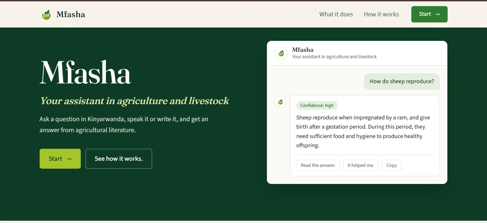
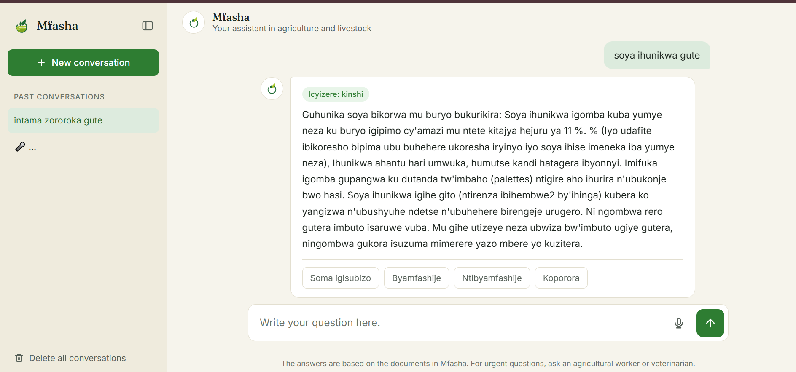

# MFASHA: Kinyarwanda Agriculture Chatbot (Text and Voice)

A farmer types a question or records a voice message in Kinyarwanda. MFASHA replies with a
**verified, officer-reviewed** answer in writing. It **never generates advice**:
it retrieves reviewed passages from a knowledge base and **refers the farmer to an agricultural officer**
whenever it is not sure.

```
voice -> speech-to-text -> preprocessing -> classification -> retrieval -> referral policy -> answer
```

## Table of contents

1. [Project overview](#1-project-overview)
   - [Screenshots](#screenshots)
2. [Technical requirements](#2-technical-requirements)
3. [Installation](#3-installation)
4. [Configuration](#4-configuration)
5. [API](#5-api)
6. [Repository structure](#6-repository-structure)
7. [Results](#7-results)
8. [Testing and code quality](#8-testing-and-code-quality)
9. [Walkthrough video](#9-walkthrough-video)
10. [Technical report](#10-technical-report)
11. [Data and model sources](#11-data-and-model-sources)

---

## 1. Project overview

MFASHA is a FastAPI web application with a plain HTML/CSS/JS farmer interface (in Kinyarwanda). The
model work (retrieval fine-tuning, speech recognition, speech synthesis, evaluation) was done in a
notebook (`Notebooks/mfasha_notebook.ipynb`); this repository turns those results into a deployable
service.

**How a question is answered** (`src/mfasha/pipeline.py`):

1. **Speech-to-text** (voice only): the browser records audio and converts it to 16 kHz mono WAV; the
   server transcribes it with MMS (`facebook/mms-1b-all`, Kinyarwanda adapter).
2. **Preprocessing**: text cleaning and tokenising.
3. **Classification**: the question is assigned to one of 8 topic categories (TF-IDF + SVM/LR, with a
   keyword labeller as fallback).
4. **Retrieval**: the top passages are retrieved from the knowledge base (BM25, TF-IDF, a weighted hybrid
   of the two, or dense e5 embeddings).
5. **Referral policy**: a chain of rules decides whether to answer or refer (see below).
6. **Answer**: the text of the best passage is returned together with its review status and source.

**When MFASHA refers instead of answering** (`src/mfasha/referral/policy.py`). Rules are tried in order
and the first that fires gives the reason:

| Reason | Meaning |
|---|---|
| `low_retrieval_score` | best passage scores below the threshold (default 0.20) |
| `ambiguous_top_passages` | top two passages are almost tied (default margin 0.02) |
| `classifier_retriever_disagree` | classifier category differs from the passage category |
| `passage_not_reviewed` | passage has not been signed off by an officer (unless `MFASHA_SERVE_UNREVIEWED=true`) |
| `empty_question`, `no_retrieval_result`, `speech_not_understood` | input problems |

**Design notes** (visible in the code): dependency injection with a single composition root
(`factory.py`), abstract interfaces for retriever / classifier / STT (`interfaces.py`),
"unavailable" null objects when speech is switched off, constant-time API key check, upload size and
duration limits, and per-stage latency timing on every response.

### Screenshots

**Landing page.** Farmers can start asking questions straight away or read how MFASHA works first.



**Chat page.** A question in Kinyarwanda gets a verified answer with a confidence badge, buttons to give feedback and copy it, and a list of past conversations. Questions can be typed or spoken
with the microphone button.



---

## 2. Technical requirements

### Software

| Component | Requirement | Source |
|---|---|---|
| Python | **3.10 or newer** (`requires-python = ">=3.10"`); Docker image uses 3.11 | `pyproject.toml`, `Dockerfile` |
| Web framework | FastAPI >= 0.110, Uvicorn[standard] >= 0.29, python-multipart >= 0.0.9 | `requirements.txt` |
| Validation | Pydantic >= 2.6 | `requirements.txt` |
| Database | SQLAlchemy >= 2.0; SQLite by default, PostgreSQL via `DATABASE_URL` (`psycopg2-binary >= 2.9`) | `requirements.txt` |
| ML (core) | NumPy >= 1.26, scikit-learn >= 1.4, joblib >= 1.3 | `requirements.txt` |
| ML  | PyTorch (unpinned), Transformers >= 4.40, sentence-transformers >= 3.0 | `requirements-ml.txt` |
| Dev tools | pytest >= 8, pytest-cov >= 5, httpx >= 0.27, ruff >= 0.4 | `requirements-dev.txt` |
| Containers  | Docker; Compose file uses `postgres:16-alpine` | `docker-compose.yml` |
| Frontend | No build step; no framework. A modern browser with microphone access for voice | `frontend/` |

### Hardware

- **Text mode with BM25 / TF-IDF / hybrid retrieval**: no GPU and no downloads. This is the
  configuration measured in the benchmarks below (4-core Intel CPU, Windows 10, Python 3.13.3).
- **Voice (STT) and the e5 embedding retriever**: need `requirements-ml.txt`. `.env.example` notes that
  enabling STT needs about **4 GB of RAM**. The notebook experiments (fine-tuning) were run with a GPU
  runtime.

---

## 3. Installation

### 3.1 Get the code

```bash
git clone https://github.com/carine-ahishakiye/Mfasha-Chatbot-.git
cd Mfasha-Chatbot-
```

### 3.2 Create an environment and install

```bash
python -m venv .venv
source .venv/bin/activate          # Windows PowerShell: .venv\Scripts\Activate.ps1
pip install -r requirements-dev.txt
pip install -e .
```

### 3.3 Provide the knowledge base

The application needs a passages file (`passages.jsonl`, one JSON object per line with `pid` and `text`)
and, optionally, a CSV of officer-reviewed passage ids (column `pid`). The defaults point to
`data/sample/passages.jsonl` and `data/sample/officer_reviewed_passages.csv`. The `data/` folder is
**not tracked by Git** in this repository (it is large), so you must create or supply these files.

> Passages are only served if their id is in the reviewed-passages CSV. With no reviewed file (and
> `MFASHA_SERVE_UNREVIEWED=false`) every question is referred to an officer with reason
> `passage_not_reviewed`. This is intentional.

**Option A: build the real knowledge base from the public dataset** (needs internet):

```bash
pip install huggingface_hub pandas openpyxl
python scripts/prepare_data.py --out data/processed       # downloads C4IR-RW/kinya-ag-retrieval
python make_review.py                                      # writes data/processed/officer_reviewed_passages.csv
                                                           # from results/review_sheet_all_passages.xlsx
```

**Option B: import the artifacts produced by the notebook** (passages, officer labels and reviews,
referral threshold, classifier, fine-tuned models):

```bash
python scripts/import_notebook_artifacts.py --drive "/path/to/Mfasha chatbot"
```

Then point the app at the files (section 4):

```
MFASHA_KNOWLEDGE_PATH=data/processed/passages.jsonl
MFASHA_REVIEWED_PATH=data/processed/officer_reviewed_passages.csv
MFASHA_LABELS_PATH=data/processed/category_labels_officer.csv     # optional
```

### 3.4 Run the application

The code reads settings from **environment variables only** and does not load `.env` by itself, so pass
the file to Uvicorn:

```bash
cp .env.example .env               # Windows PowerShell: Copy-Item .env.example .env
uvicorn mfasha.api.main:create_app --factory --port 8000 --env-file .env
```

- Welcome page: http://localhost:8000 (farmers go on to `chat.html`, officers to `officer.html`)
- Interactive API docs: http://localhost:8000/docs
- Health check: http://localhost:8000/api/health

(`make run` starts the same app with `--reload` but does not read `.env`; set variables in your shell
or use the command above.)

### 3.5 Optional: voice and the fine-tuned retriever

```bash
pip install -r requirements-ml.txt
```

Then in `.env`:

```
MFASHA_ENABLE_STT=true
MFASHA_RETRIEVER=embedding
```

Model folders are looked up under `models/` (not tracked by Git): `kinya-e5-large/best` (retriever),
`mms-kin-adapter` (STT adapter), `classifier.joblib`,
`referral_threshold.json`. If a folder is missing, the code falls back to the public Hugging Face model
named in section 11 (or, for the classifier, trains a small one on the knowledge base at startup).

### 3.6 Optional: Docker

```bash
docker compose up --build          # app on http://localhost:8000 with PostgreSQL 16
```

The image build copies `data/sample/` (`COPY data/sample ./data/sample`), so that folder must exist in
the build context. The compose file also mounts `./data` and `./models` into the container. Set
`INSTALL_ML=true` as a build argument to include `requirements-ml.txt` in the image.

---


### Officer sign-in (phone number + PIN)

The site opens on a welcome page (`/`) that asks **who are you**:
- **Farmer** goes straight to the chat (`chat.html`). There is no account and no login.
- **Officer** goes to `officer.html`, where they **create an account** or **sign in** with a phone number and a
  4 to 6 digit PIN. Creating an account needs the sign-up code set in `.env` as `MFASHA_OFFICER_CODE`
  (give it only to real officers; with no code set, sign-up is closed).

An administrator can also register officers from the project folder (the PIN is asked without showing on screen):

```bash
python scripts/add_officer.py add --phone 0788123456 --name "Mukamana Jeanne"
python scripts/add_officer.py list
python scripts/add_officer.py deactivate --phone 0788123456
```

Running `add` again for the same phone number resets that officer's PIN. PINs are stored only as salted hashes.
Five wrong PINs lock a phone number for five minutes. A login lasts 12 hours. Set `MFASHA_SECRET_KEY`
in `.env` so officers stay signed in when the server restarts.

## 4. Configuration

All settings are environment variables (defined in `src/mfasha/config.py`; template in `.env.example`).

| Variable | Default | Purpose |
|---|---|---|
| `DATABASE_URL` | `sqlite:///<repo>/mfasha.db` | SQLite or PostgreSQL connection string |
| `MFASHA_RETRIEVER` | `hybrid` | `bm25`, `tfidf`, `hybrid` or `embedding` |
| `MFASHA_EMBEDDING_MODEL` | `intfloat/multilingual-e5-large` | used when no `models/kinya-e5-large/best` exists |
| `MFASHA_KNOWLEDGE_PATH` | `data/sample/passages.jsonl` | knowledge base file |
| `MFASHA_REVIEWED_PATH` | `data/sample/officer_reviewed_passages.csv` | ids of officer-approved passages |
| `MFASHA_LABELS_PATH` | none | officer-corrected categories (`pid`, `category`) |
| `MFASHA_MODELS_DIR` | `models/` | folder with fine-tuned models |
| `MFASHA_REFERRAL_THRESHOLD` / `MFASHA_REFERRAL_MARGIN` | `0.20` / `0.02` | referral rule parameters (overridden by `models/referral_threshold.json` if present) |
| `MFASHA_USE_AGREEMENT` | `true` | enable the classifier/retriever agreement rule |
| `MFASHA_SERVE_UNREVIEWED` | `false` | allow passages not signed off by an officer (keep `false` for the pilot) |
| `MFASHA_ENABLE_STT` | `false` | switch speech-to-text on (needs `requirements-ml.txt`) |
| `MFASHA_STT_MODEL` | `facebook/mms-1b-all` | Hugging Face model ids |
| `MFASHA_API_KEY` | empty | administrator key (`X-API-Key`) for `/api/officer/*` and `/api/admin/*`; empty disables key access (HTTP 503) |
| `MFASHA_SECRET_KEY` | random at every start | signs officer login tokens; set it so officers stay signed in after a restart |
| `MFASHA_CORS_ORIGINS` | `*` | comma-separated allowed origins |

Fixed limits in `Settings`: questions up to 500 characters, audio up to 5,000,000 bytes and 30 seconds.

---

## 5. API

| Method and path | Who | Purpose |
|---|---|---|
| `GET /api/health` | anyone | status, passage counts, active components |
| `POST /api/ask/text` | farmer | JSON `{question, with_audio}` returns an answer |
| `POST /api/ask/voice` | farmer | multipart WAV (`audio`, `with_audio`) returns an answer plus the transcription |
| `POST /api/feedback` | farmer | rating 1-5 and useful yes/no for an answer |
| `POST /api/officer/login` | none | phone number + PIN, returns a 12-hour token (5 wrong PINs lock the number for 5 minutes) |
| `POST /api/officer/reviews` | officer (Bearer token) or admin (`X-API-Key`) | correct / partially correct / incorrect, plus relevant / clear / safe |
| `GET /api/admin/stats` | admin (`X-API-Key`) | referral rate, latency, ratings, officer-correct rate |

Every answer is logged (question, answer, components used, per-stage timings) so feedback and officer
reviews can be attached to it. Example:

```bash
curl -X POST http://localhost:8000/api/ask/text \
     -H "Content-Type: application/json" \
     -d '{"question": "Ni gute nahinga ibigori?", "with_audio": false}'
```

Error responses: `422` invalid audio or too-long question, `413` audio too large, `503` speech not
enabled, `401` wrong API key, `404` unknown `answer_id`.

---

## 6. Repository structure

```
.
├── src/mfasha/
│   ├── api/              FastAPI app factory (main.py), routes, request/response schemas
│   ├── classification/   keyword labeller, TF-IDF + LR/SVM question classifier
│   ├── domain/           data objects (Passage, PipelineResult, ReferralReason) and exceptions
│   ├── knowledge/        knowledge base and loader (reviewed flags, officer labels)
│   ├── nlp/              text cleaning and tokenising
│   ├── referral/         referral rules (chain of responsibility) and threshold tuning
│   ├── retrieval/        BM25 (implemented from scratch), TF-IDF, hybrid fusion, dense e5 embeddings
│   ├── speech/           WAV helpers, MMS speech-to-text, "unavailable" null objects
│   ├── storage/          SQLAlchemy tables, database session, repository
│   ├── config.py         settings from environment variables
│   ├── factory.py        composition root: the only place that picks concrete classes
│   ├── interfaces.py     abstract Retriever, Classifier, SpeechToText, TextToSpeech
│   └── pipeline.py       the pipeline with per-stage timing
├── frontend/             farmer web app: index.html, app.js, styles.css
├── scripts/              prepare_data, train_classifier, evaluate_retrieval, benchmark, import_notebook_artifacts
├── tests/
│   ├── unit/             audio, BM25, classifiers and KB, hybrid and TF-IDF, preprocessing, referral
│   ├── integration/      API and pipeline tests (fakes replace the heavy models)
│   └── performance/      latency budget test
├── Notebooks/            mfasha_notebook.ipynb (data prep, retrieval fine-tuning, ASR, end to end)
├── results/              evaluation outputs (CSV/JSON), plots/, officer review sheets, label drafts
├── benchmark_*.json      latency and throughput measurements from scripts/benchmark.py
├── make_review.py        builds officer_reviewed_passages.csv from the officer review spreadsheet
├── Dockerfile, docker-compose.yml, Makefile
├── pyproject.toml, requirements.txt, requirements-ml.txt, requirements-dev.txt
└── .env.example
```

Not tracked by Git (see `.gitignore`): `data/`, `models/`, `.venv/`, `.env`, `*.pkl`, `*.wav`, model weight
files.

---

## 7. Results

All numbers below are copied from the files in `results/`. "Seen" test questions come from passages
that were in the fine-tuning data; "unseen" test questions come from passages held out of training
(see the notebook's split cell).

### 7.1 Retrieval (`results/retrieval_final_test_all_systems.csv`)

| System | Split | R@1 | R@5 | MRR@10 |
|---|---|---|---|---|
| BM25 | seen / unseen | 0.487 / 0.489 | 0.740 / 0.726 | 0.595 / 0.599 |
| TF-IDF (word 1-2) | seen / unseen | 0.469 / 0.401 | 0.727 / 0.684 | 0.582 / 0.528 |
| TF-IDF (char 3-5) | seen / unseen | 0.513 / 0.568 | 0.806 / 0.851 | 0.637 / 0.687 |
| multilingual-e5 (not fine-tuned) | seen / unseen | 0.400 / 0.316 | 0.619 / 0.502 | 0.491 / 0.396 |
| **e5 fine-tuned** | seen / unseen | **0.893 / 0.866** | **0.990 / 0.988** | **0.936 / 0.923** |
| BM25 + e5 fine-tuned (w=2.0) | seen / unseen | 0.745 / 0.790 | 0.932 / 0.973 | 0.825 / 0.870 |

The fine-tuned e5 model was the best system on both splits. The application's **default** retriever is
`hybrid` (BM25 + TF-IDF, weights 0.6 / 0.4), which runs without any model download; its accuracy on this
test set is **not** reported in `results/`. The fine-tuned model is used by setting
`MFASHA_RETRIEVER=embedding` with the model in `models/kinya-e5-large/best`.

### 7.2 Speech-to-text (`results/asr_finetuned_test.csv`)

| System | WER | CER |
|---|---|---|
| MMS-1b-all (Kinyarwanda adapter) | 0.301 | 0.063 |
| MMS adapter fine-tuned | **0.277** | **0.058** |

### 7.4 Out-of-scope questions (`results/oos_results.csv`)

40 questions outside the knowledge base (not agriculture, financial, legal, medical, and farming
questions probably not covered): **all 40 were referred** to an officer, none answered.

### 7.5 Latency and throughput (`benchmark_*.json`, from `scripts/benchmark.py`)

Machine: Windows 10, Python 3.13.3, 4 logical CPUs, 8 client threads. STT was disabled in
every run, so these figures cover the text pipeline only.

| Run | Passages | Retriever | p50 | p95 | Throughput |
|---|---|---|---|---|---|
| `benchmark_hybrid_941.json` | 941 | hybrid | 46.0 ms | 54.9 ms | 43.1 req/s |
| `benchmark_embedding_941.json` | 941 | embedding | 716.1 ms | 1049.7 ms | 1.7 req/s |
| `benchmark_laptop.json` | 12 | hybrid | 8.8 ms | 60.1 ms | 137.6 req/s |
| `benchmark_light_60runs.json` | 12 | hybrid | 12.3 ms | 52.0 ms | 68.0 req/s |

The embedding run also recorded one outlier of about 121 s (its p99 and max); the cause was not
investigated. Start-up took about 18 s with 941 passages versus under 0.3 s with 12.

### 7.6 Knowledge base and officer review

- The benchmarked knowledge base has **941 passages**.
- `results/review_sheet_all_passages.xlsx` has one row per passage (941 rows), all with
  `review_status = correct`; `make_review.py` turns these into the reviewed-passage list the app uses.
- `results/category_labels_draft.csv` holds the keyword-labeller's draft categories (8 categories used in
  code; 7 occur in the draft). Its `officer_category` column is empty in the committed copy.
- `results/officer_review_sheet.csv` (200 rows) is an unfilled review template: its `verdict` and
  `reviewer` columns are empty in the committed copy.

---

## 8. Testing and code quality

```bash
make test       
make perf       
make cov        
make lint       
```

Without `make`, run `pytest -m "not performance"` and `ruff check src tests scripts` directly.

| Suite | Files | What it covers |
|---|---|---|
| `tests/unit/` | 6 | audio decoding, BM25, hybrid + TF-IDF, preprocessing, classifiers and knowledge base, referral rules |
| `tests/integration/` | 2 | the HTTP API and the full pipeline (answer, referral, empty input, unreviewed passage never served, voice with fake STT, every retriever choice builds) |
| `tests/performance/` | 1 | text pipeline latency budget |

62 tests are collected in total (61 plus the performance test). The integration tests use small fake
STT class (`tests/conftest.py`) so the suite runs offline in about a second. **They read the
knowledge base from `data/sample/`**, so that folder must be present for the integration tests to run.

Code quality practices in the repository:

- **Linting**: ruff (rules E, F, I, B, UP; line length 110) configured in `pyproject.toml`.
- **Layered architecture** with interfaces and dependency injection, so components are swapped by
  configuration and replaced by fakes in tests.
- **Separation of concerns**: thin HTTP routes, a pipeline that owns stage order but not stage logic,
  single-purpose referral rule classes.
- **Input validation and safety**: size and duration limits, constant-time key comparison, the
  frontend writes answers with `textContent` (no HTML injection).
- **Reproducibility**: pinned minimum versions, Dockerfile with a non-root user and a health check,
  results and benchmark files committed alongside the code.

---

## 9. Walkthrough video

[Watch the walkthrough video](https://drive.google.com/file/d/1dX1bElXRN0jQPMJG-gUhC0-cSth29_TQ/view?usp=sharing)

---

## 10. Technical report

[Read the technical report](https://drive.google.com/file/d/1fCGWlLDgnMNojanflFUv4JIrvKef4C1B/view?usp=sharing)

---

## 11. Data and model sources

| Resource | Used for | License (from `results/candidate_audit.json`) |
|---|---|---|
| `C4IR-RW/kinya-ag-retrieval` (Hugging Face dataset) | passages and questions for retrieval | cc-by-4.0 |
| `intfloat/multilingual-e5-large` | base retrieval model that was fine-tuned | see model card |
| `facebook/mms-1b-all` (adapter `kin`) | speech-to-text | see model card |

`results/candidate_audit.json` also lists the candidate models and datasets that were audited
(`C4IR-RW/kinyabert`, `C4IR-RW/kiny-colbert-free`, `C4IR-RW/kinya-flex-tts`).

---